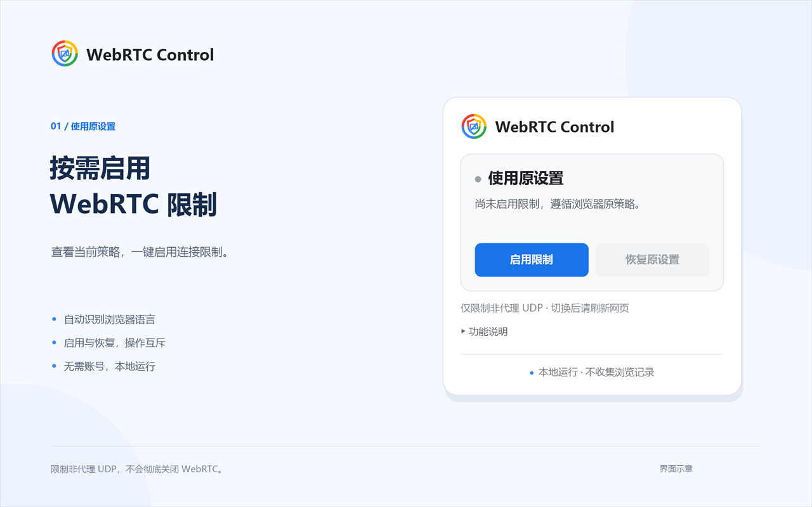
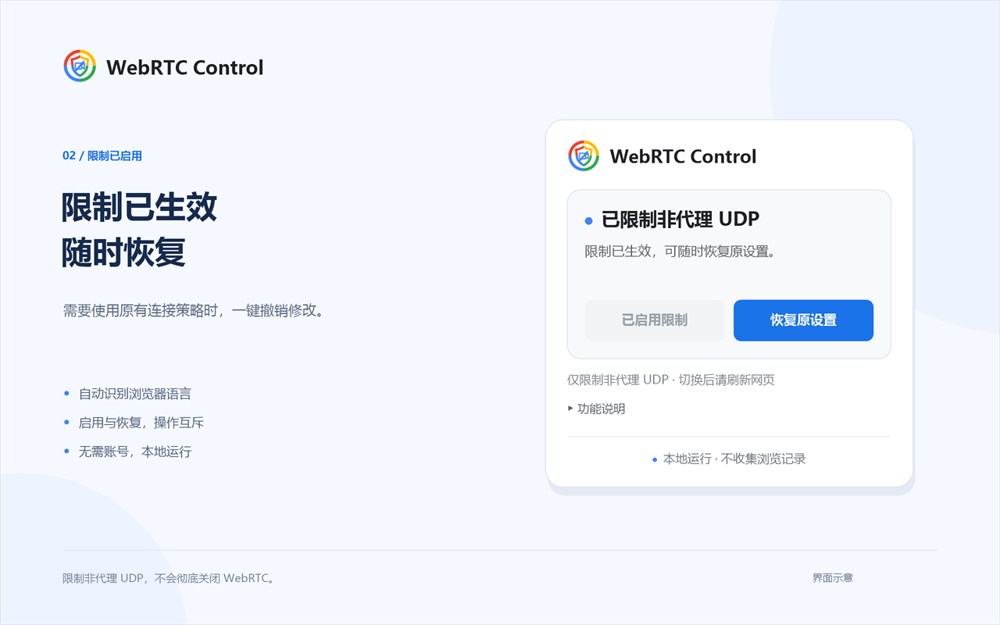

# WebRTC Control

一个轻量的 Chrome / Edge 扩展，用于一键限制 WebRTC 非代理 UDP、查看当前连接策略，并恢复浏览器原有设置。

[从 Edge 扩展商店安装](https://microsoftedge.microsoft.com/addons/detail/webrtc-control/gaednpknajiajjmnmiolffcbnoggdhcc) · [下载 v1.0.1 安装包](dist/WebRTC-Control-1.0.1.zip) · [安装方法](#安装) · [隐私与权限](#隐私与权限) · [开发与打包](#开发与打包)

**发布状态：** Edge 扩展商店已上架；Chrome 网上应用店正在发布中，暂未提供商店安装链接。

> 本扩展限制的是 WebRTC 的非代理 UDP 连接，不会彻底关闭 WebRTC，也不保证隐藏所有 IP 地址。

## 功能

- **一键限制与恢复**：启用限制，或仅撤销本扩展对浏览器策略的修改。
- **显示实际状态**：读取浏览器当前生效的策略，提示其他扩展或管理策略的控制情况。
- **互斥操作**：可用按钮以蓝色显示，不可用按钮置灰，操作期间暂停重复点击。
- **保留设置**：关闭并重新打开浏览器后，已生效的策略继续保留。
- **自动语言**：跟随浏览器首选语言，支持简体中文、繁体中文和英文，无需手动切换。
- **本地运行**：无需账号，没有远程代码、统计服务或第三方运行依赖。

## 界面预览

以下为根据当前界面绘制的展示图，分别展示使用原设置和启用限制后的状态。

| 使用原设置 | 已启用限制 |
| --- | --- |
|  |  |

## 安装

### 从扩展商店安装

- **Microsoft Edge**：打开 [WebRTC Control 商店页面](https://microsoftedge.microsoft.com/addons/detail/webrtc-control/gaednpknajiajjmnmiolffcbnoggdhcc)，点击「获取」并确认添加扩展。
- **Google Chrome**：Chrome 网上应用店正在发布中。商店上架前，可以按下方步骤从安装包或源码加载。

### 从安装包加载

1. 下载并解压 [WebRTC-Control-1.0.1.zip](dist/WebRTC-Control-1.0.1.zip)。
2. 在浏览器地址栏打开扩展管理页：
   - Chrome：`chrome://extensions`
   - Edge：`edge://extensions`
3. 开启「开发者模式」。
4. 点击「加载已解压的扩展程序」，选择解压后包含 `manifest.json` 的目录。
5. 将 WebRTC Control 固定到工具栏，点击图标打开操作界面。

### 从源码加载

下载或克隆本仓库后，按上面的步骤加载仓库根目录即可。安装和使用扩展不需要 Node.js，也不需要执行构建命令。

更新本地安装的版本时，替换完整文件后，在扩展管理页点击「重新加载」。

## 使用

首次安装不会自动修改 WebRTC 策略。打开弹窗后：

1. 点击「启用限制」，限制 WebRTC 使用非代理 UDP。
2. 切换后刷新目标网页，让新连接采用更新后的策略。
3. 需要撤销时，点击「恢复原设置」，再刷新网页。

| 状态 | 操作 |
| --- | --- |
| 尚未启用本扩展的限制 | 可点击「启用限制」，「恢复原设置」置灰 |
| 限制由本扩展管理 | 可点击「恢复原设置」，启用按钮置灰 |
| 操作进行中或读取状态失败 | 两个按钮暂不可用；读取失败时可重试 |
| 限制来自浏览器原策略，或设置被外部策略控制 | 显示原因，不提供无法生效的操作 |

工具栏上的 `ON` 表示非代理 UDP 限制正在生效；`!` 表示设置由其他扩展或管理策略控制，或状态读取失败。打开弹窗可以查看具体信息。

## 隐私与权限

扩展只申请 **`privacy`** 权限，用于读取和修改 `chrome.privacy.network.webRTCIPHandlingPolicy`。

- 不申请网站访问权限，不读取网页内容。
- 不收集浏览记录或其他用户数据，不向外部发送数据。
- 不加载远程脚本、远程字体或统计 SDK。
- 所有界面、图标和语言文案随扩展提供。

「启用限制」设置 `disable_non_proxied_udp`；「恢复原设置」通过 `clear()` 撤销本扩展的设置，而不是强行写入默认值。

## 功能边界

- **不是 WebRTC 总开关**：允许的 TCP 或代理连接仍可能成功，网页中的 WebRTC 接口也可能继续存在。
- **不是 IP 隐藏工具**：不会隐藏普通网页请求的出口 IP，也不能替代代理或 VPN。
- **可能影响网页功能**：部分语音、视频通话和文件传输可能失败或改变连接方式。
- **不主动断开已有连接**：切换后需要刷新网页，重新建立连接。
- **按浏览器配置文件生效**：不提供按网站开关。弹窗读取普通窗口的策略；隐身窗口可能继承该策略，也可能有单独覆盖。
- **遵循浏览器控制规则**：其他扩展或管理策略可能接管设置，扩展会提示冲突，不尝试强行覆盖。

## 常见问题

### 关闭浏览器后会恢复原设置吗？

不会。浏览器会保留本扩展设置的普通窗口策略。点击「恢复原设置」，或禁用、卸载本扩展，才会撤销本扩展的修改。

### 为什么恢复后仍显示限制？

恢复只撤销本扩展的设置。如果浏览器原策略本来就限制非代理 UDP，撤销后仍会显示限制状态。

### 为什么无法点击按钮？

当前操作已经生效、操作正在进行，或设置由其他扩展、管理策略控制时，相应按钮不可点击。以弹窗中的实际提示为准。

### 界面如何选择语言？

语言来源按以下优先级读取：

1. `navigator.languages[0]`：浏览器第一首选语言。
2. `navigator.language`。
3. `chrome.i18n.getUILanguage()`：浏览器界面语言。

`zh-TW`、`zh-HK`、`zh-MO`、`zh-Hant` 使用繁体中文；其他中文语言标识使用简体中文；非中文语言使用英文。更改首选语言后，关闭并重新打开弹窗即可重新读取。

扩展管理页的简短介绍由浏览器原生国际化机制决定，可能与弹窗采用的首选语言不同。

## 开发与打包

### 环境

- 扩展使用 Manifest V3，声明的最低 Chrome 版本为 96。
- 测试验证环境：Node.js 24；测试使用 Node.js 内置测试工具，无需安装依赖。
- 打包与宣传图生成脚本目前面向 Windows + PowerShell 7；宣传图使用系统绘图库和微软雅黑字体。

### 运行测试

在仓库根目录执行：

```sh
node --test tests/*.test.js
```

测试覆盖策略切换与恢复、外部控制、异常提示、按钮互斥、语言回退，以及首选语言为繁体但浏览器界面语言仍为简体的情况。测试模拟浏览器 API；真实浏览器中的加载和联网效果仍需另行验证。

### 生成商店上传包

在仓库根目录的 PowerShell 7 中执行：

```powershell
./scripts/package-release.ps1
```

脚本读取 `manifest.json` 的版本号，自动创建 `dist/`，检查运行文件是否齐全，生成并校验 ZIP 后才替换同版本安装包。默认输出为 `dist/WebRTC-Control-1.0.1.zip`。上传包的根目录包含 `manifest.json`，只收录运行代码、图标和语言文件，不包含测试、脚本或宣传素材。

修改语言文案时，需要同步更新 `_locales/` 中对应的 `messages.json` 和根目录 `messages.js`；测试会检查它们是否一致。发布更新前，请递增 `manifest.json` 中的版本号，再重新打包。

### 生成商店展示图

在 Windows 的 PowerShell 7 中执行：

```powershell
./scripts/render-store-assets.ps1
```

输出到 `store-assets/zh-CN/`、`store-assets/zh-TW/` 和 `store-assets/en/`。每种语言包含一张 440 × 280 宣传图及两张 1280 × 800 界面示意图，均为不带透明通道的 24 位 PNG。

## 项目结构

```text
WebRTC-Control/
├── manifest.json       # 扩展声明与权限
├── background.js       # 工具栏徽标与提示
├── policy.js           # WebRTC 策略操作
├── i18n.js             # 自动语言选择
├── messages.js         # 内置界面文案
├── popup.html          # 弹窗结构
├── popup.css           # 弹窗样式
├── popup.js            # 状态与按钮交互
├── _locales/           # 浏览器原生语言目录
├── icons/              # 各尺寸图标
├── scripts/            # 打包与展示图生成脚本
├── tests/              # 回归测试
├── store-assets/       # 商店文案、图标与展示图
└── dist/               # 商店上传包
```

## 参考

- [Chrome privacy API](https://developer.chrome.com/docs/extensions/reference/api/privacy)
- [ChromeSetting 的作用域与生命周期](https://developer.chrome.com/docs/extensions/reference/api/types)
- [Chrome 网上应用店发布指南](https://developer.chrome.com/docs/webstore/publish)
- [Microsoft Edge 扩展发布指南](https://learn.microsoft.com/en-us/microsoft-edge/extensions/publish/publish-extension)
